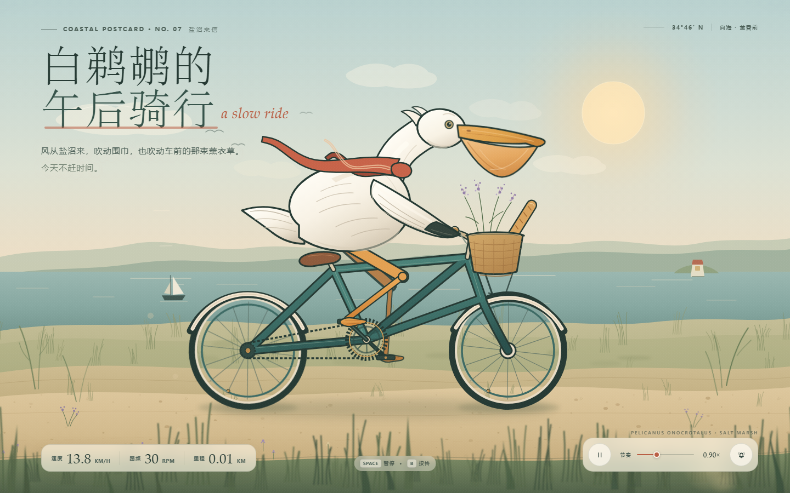

<h1 align="center">白鹈鹕的午后骑行</h1>

<p align="center"><strong>Pelican Slow Ride</strong><br>
一只白色鹈鹕骑着青绿色自行车，穿过黄昏的盐沼。</p>

<p align="center"><code>HTML</code> · <code>SVG</code> · <code>CSS</code> · <code>JavaScript</code><br>
单文件 · 零依赖 · 响应式 · GitHub Pages 就绪</p>

<p align="center"><sub>Made with DSH (DeepSeek Harness) + DeepSeek Flash</sub></p>

<p align="center"><a href="https://zeyu118-abc.github.io/pelican-slow-ride/"><strong>↗ 在线预览</strong></a></p>



## 关于

这是一个用原生 HTML、SVG、CSS 和 JavaScript 绘制并驱动的动画小场景。鹈鹕围着锈红围巾，车篮里放着一根法棍和一束薰衣草；它会在盐沼小路上不紧不慢地骑下去。

页面没有构建步骤、外部字体或第三方库，所有插画、动画和样式都在 `index.html` 里。双击打开就能看，也可以直接部署到 GitHub Pages。

## 它是怎么产生的

项目始于一句简单的自然语言需求：

> 做一个白色鹈鹕骑自行车的动画网页。

从分镜、插画、SVG 路径、动画节奏，到响应式布局和 GitHub Pages 发布配置，整个项目都在 **DSH（DeepSeek Harness）** 中由 **DeepSeek Flash** 模型通过多轮对话生成、检查和调整。人工负责提出方向、确认画面和验收结果。

- **生成工具：** DSH（DeepSeek Harness）
- **模型：** DeepSeek Flash
- **生成方式：** 自然语言对话 + 代码执行 + 浏览器验收
- **交付形式：** 单个 `index.html`，内联 SVG / CSS / JavaScript

页面里的插画不是外部图片或素材，而是直接用 SVG 路径绘制；动画也不是视频，而是由 CSS 和 JavaScript 实时驱动。页面本身在运行时不需要联网，也不依赖任何 AI 服务。

仓库创建、Git 提交和 GitHub Pages 发布，同样由 DSH 在获得账号授权后自动完成。

## 动画细节

- 车轮、曲柄、链条和车踏板持续转动
- 双腿通过反向运动学求解，脚掌跟着踏板移动
- 鹈鹕身体轻晃、头部点动、围巾随风飘动、会偶尔眨眼
- 车前篮里的花枝和座垫细节保持手绘质感
- 天空、云、帆船、芦苇、路面颗粒和前景草按不同速度视差移动
- 黄昏盐沼配色、纸张颗粒和柔光暗角
- 桌面端全屏场景，移动端变为明信片式卡片布局

## 操作

| 操作 | 效果 |
| --- | --- |
| `空格` / 暂停按钮 | 暂停或继续动画 |
| 拖动“节奏”滑杆 | 在 `0.55× – 1.65×` 之间调整骑行速度 |
| `B` / 车铃按钮 | 用 Web Audio 按响车铃 |
| 速度、踏频、里程 | 左下角骑行数据实时变化 |

页面支持 `prefers-reduced-motion`：当系统开启“减少动态效果”时，会以暂停状态打开，把播放权交给访客。

## 本地预览

最简单的方式：直接双击 `index.html`。

如果希望在本地服务器中预览：

```powershell
python -m http.server 8000
```

然后访问 `http://localhost:8000`。

没有安装 Python 的话，也可以用 VS Code 的 Live Server 插件，或任意静态文件服务器。

## 文件结构

```text
.
├─ index.html          # 完整页面：插画、动画、样式与交互
├─ assets/
│  └─ preview.png      # README 预览图
├─ README.md
├─ PUBLISH.md          # 发布到 GitHub Pages 的详细步骤与排错
├─ LICENSE
├─ .gitignore
└─ .nojekyll           # 关闭 GitHub Pages 的 Jekyll 处理
```

## 发布到 GitHub Pages

1. 新建一个 GitHub 仓库，把本目录中的文件和 `assets` 文件夹放到仓库根目录。
   `index.html` 必须和 `README.md` 位于同一层，不要多套一层文件夹。
2. 打开 **Settings → Pages**，在 **Build and deployment** 中选择 **Deploy from a branch**。
3. 选择 **main** 分支和 **/(root)** 文件夹，保存。
4. 等待 1–2 分钟，页面会发布到 `https://USERNAME.github.io/REPO/`。

详细的上传方式、Git 命令、自定义域名和常见问题，见 **[PUBLISH.md](PUBLISH.md)**。

## 自定义

- 页面主色、纸色、强调色等都在 `index.html` 的 `:root` 变量里。
- 标题和文案在 `.masthead` 区块中。
- 默认节奏是 `#paceRange` 的 `value="0.9"`，可在 `0.55–1.65` 之间调整。
- 鹈鹕、自行车和场景组件都带有 `id`，例如 `#pelican`、`#nearLeg`、`#basketGroup`；可以直接修改内联 SVG。
- 替换 `assets/preview.png` 即可更新 README 预览图。

## 兼容性

- 现代 Chrome、Edge、Firefox、Safari。
- 无外部资源依赖，离线可用。
- 铃声需要浏览器允许音频，并且会在第一次点击/按键后才播放；这是浏览器的自动播放限制造成的。

## 许可

本项目使用 [MIT License](LICENSE)，版权人为 `zeyu118-abc`。如果你将它用作自己的项目，可以按需替换 `LICENSE` 中的版权人。

---

如果在某个下午，这只鹈鹕也让你慢下来了一点，欢迎给它一颗 ⭐。
